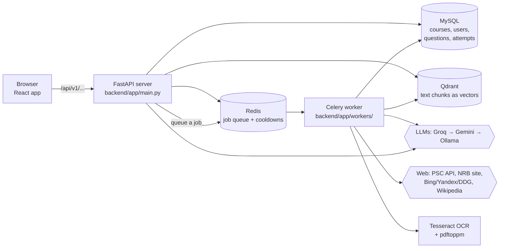
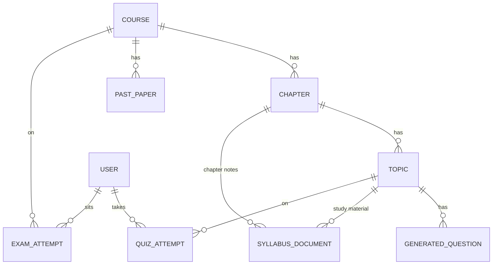
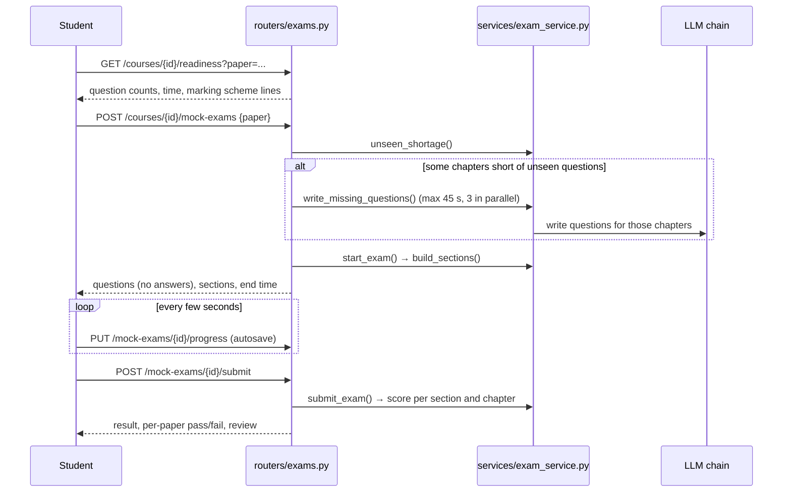

# How QuizForge works

This guide explains how the platform runs: the programs involved, how a request
moves through them, the main flows (building a question bank, finding past papers,
sitting an exam), and what every folder and file is for.

For setup commands, see the [README](../README.md).

---

## 1. The big picture

QuizForge is made of **four programs of its own** plus **three data stores**,
and it calls a few **outside services**.



| Program | What it does | How to start it (dev) |
|---|---|---|
| **Frontend** (React + Vite) | The website students and admins use. Sends every request to `/api/...`. | `cd frontend && npm run dev` (port 5173) |
| **API server** (FastAPI + Uvicorn) | Handles every request: login, courses, quizzes, exams, admin. Fast work happens here; slow work goes to the queue. | `venv/bin/uvicorn app.main:app --port 8000` |
| **Celery worker** | Runs slow background jobs: reading PDFs, web research, writing questions with AI, finding and OCR-ing past papers. | `venv/bin/celery -A app.workers.celery_app worker --pool=solo` |
| **Alembic** | Creates and upgrades the database tables. Runs once per upgrade. | `venv/bin/alembic upgrade head` |

| Data store | What is kept there |
|---|---|
| **MySQL** (Docker, port 3307) | Everything permanent: users, courses → chapters → topics, questions, quiz and exam attempts, past papers, settings. |
| **Qdrant** (vector database, port 6333) | Study material cut into small pieces ("chunks") and stored as number vectors, so the AI can be given the most relevant notes for a topic. |
| **Redis** (port 6379) | The job queue between the API and the worker, job results, AI rate-limit cooldowns, login-throttle counters. |

### Cloud first, local fallback

Every outside dependency has a backup, chosen automatically:

| Need | First choice | Backup |
|---|---|---|
| AI model | Groq `openai/gpt-oss-120b` (then `gpt-oss-20b`), then Gemini | Ollama `mistral:7b` running on your machine |
| Vector database | Qdrant Cloud | local Qdrant container |
| Queue / cache | Redis Cloud | local Redis container |
| Web search | Bing → Yandex → DuckDuckGo (via `ddgs`) | Wikipedia API |

- `app/infra.py` checks once at start-up whether the cloud Qdrant and Redis answer. If they don't, it uses the local ones.
- `app/services/generation_service.py` tries the AI providers in order. When one answers "rate limited", it puts that provider on a **cooldown** in Redis (as long as the provider asks, or 15 minutes for daily limits) and moves on to the next.
- Background jobs run in **patient mode**: instead of failing when every provider is cooling down, they wait for the shortest cooldown and retry.

---

## 2. The data model



| Table | Important columns | Meaning |
|---|---|---|
| `courses` | `exam_question_count`, `exam_duration_minutes` (per paper), `negative_marking`, `pass_percent`, `marks_per_question`, `pass_rule` (`per_paper`/`overall`), `exam_instructions`, `is_published` | One exam a student prepares for, with its official marking scheme. |
| `chapters` | `name`, `order`, `weight`, `paper` | A syllabus unit. `weight` = how many exam questions come from it. `paper` = "Paper I", "Paper II"… |
| `topics` | `name`, `description`, `has_content` | A sub-topic of a chapter. Questions belong to topics. |
| `generated_questions` | `question_text`, `options`, `correct_index`, `explanation`, `difficulty`, `source`, `reference`, `question_hash` | One MCQ. `source`/`reference` say where it came from (notes, AI, web, past paper + URL). `question_hash` blocks duplicates. |
| `syllabus_documents` | `filename`, `source_type` (pdf/web/notes), `status`, `chunk_count` | A piece of study material that was cut into chunks and stored in Qdrant. |
| `past_papers` | `source` (psc/nrb/web/upload), `year`, `page_url`, `file_url`, `status`, `ocr`, `pages`, `mcq_found`, `mcq_added`, `error` | A past exam paper found online or uploaded. Status: `found` → `processing` → `done` / `no_mcq` / `failed`. |
| `quiz_attempts` | `question_ids`, `answers`, `score`, `difficulty` | A practice quiz on one topic. |
| `exam_attempts` | `paper`, `question_ids`, `answers`, `flagged`, `time_limit_seconds`, `sections`, `section_results`, marking fields, `chapter_breakdown` | A timed mock exam. The marking scheme is **copied in** at start, so later course edits never change old results. |
| `users` | `email`, `hashed_password`, `is_admin`, `is_active` | Accounts. The first account registered becomes the admin. |
| `app_settings` | `key`, `value` (JSON) | Branding, plus progress records of running jobs (`bank_job:<id>`, `paper_job:<id>`). |

---

## 3. The main flows

### 3.1 Admin sets up a course

1. **Admin → Courses → New course**: name, exam pattern, marking scheme.
2. **Paste the syllabus** as an outline. `syllabus_service.parse_syllabus` turns it into chapters and topics:
   ```
   Paper I: Information Technology I
   Computer Architecture [3]
   - Number systems: binary, octal, hex
   - CPU organisation
   ```
   `Paper I:` starts a paper, `Name [3]` is a chapter with weight 3, and `- Topic: detail` is a topic.
3. Optionally upload PDFs for a topic. These go to the **ingestion** flow (3.2).

### 3.2 Study material → knowledge base (ingestion)

```
PDF upload (routers/topics.py)
  → saved to backend/uploads/, row in syllabus_documents (status "queued")
  → Celery job ingest_pdf (workers/ingestion_worker.py)
      → ingestion_service: pdfplumber reads the text, cuts it into overlapping chunks
      → embedding_service: all-MiniLM-L6-v2 turns each chunk into a 384-number vector
      → vector_db: stored in Qdrant collection "syllabus_chunks" (tagged with topic/chapter)
  → status "ready", topic.has_content = true
```

The study notes in `~/Desktop/nrb` go in the same way through `scripts/import_notes.py`. Each unit's notes become chapter-wide knowledge.

### 3.3 Writing questions (the question bank)

**Admin → Course → Build question bank** queues `build_course_bank` (`workers/research_worker.py`). For every topic:

1. **Find material.** `retrieval_service` asks Qdrant for the chunks closest to the topic. If there are none (or the notes are used up), `web_search_service` searches the web for the topic and saves what it finds as new chunks.
2. **Write questions.** `quiz_service.generate_for_topic` builds a prompt (`generation_service.build_prompt`) with the material, the difficulty mix and the questions already in the bank (so the AI avoids them), then calls the provider chain.
3. **Check and save.** `generation_service.parse_questions` repairs and validates the AI's JSON (4 options, a valid answer, an explanation). `dedup_service` drops anything too similar to an existing question. The rest are saved with their source.

Progress is stored in `app_settings` under `bank_job:<course>` and shown live in the admin page.

### 3.4 Past papers: find, download, OCR, extract

**Admin → Course → Sources & past papers → Find past papers** → `POST /courses/{id}/past-papers/find` → Celery `find_past_papers` (`services/paper_finder.py`):

1. **Search three places at once:**
   - **PSC (Lok Sewa Aayog):** the official question-bank API behind psc.gov.np, filtered by the course's designation (e.g. कम्प्युटर अधिकृत).
   - **NRB:** the bank's model-question archive.
   - **Web:** search engines for paper PDFs and scans. Listing pages are followed to the actual papers.
2. **List them right away.** Each candidate is saved as a `past_papers` row with status `found`, so the admin sees it immediately with an *Open* link.
3. **Read each paper** (`process_paper`, one by one):
   - Download it (`past_paper_service._download`, 12 MB cap).
   - Extract the text with `past_paper_service.extract_text`. Real-text PDFs are read directly. Scans, photos, and pages in old Nepali fonts like Preeti (detected by `looks_garbled`) are rendered with `pdftoppm` and OCR'd with **Tesseract in English + Nepali**. A web page's own text and its paper images are read too.
4. **Check for MCQs** (`looks_like_mcq`). The check accepts OCR noise such as "(a)" being read as "(9)". If the paper has no MCQs, its status becomes `no_mcq` ("Subjective").
5. **Extract** (`extract_mcqs`) with the cloud models only. The prompt carries the syllabus units and OCR hints. The model keeps the official answer if the paper gives one, otherwise solves the question and double-checks, and picks the unit each question belongs to.
6. **Save** (`store_questions`): each question is filed under the best topic inside the chosen unit and deduplicated, and the paper's status becomes `done` with `mcq_added`.

Admins can also **upload** a paper, which goes through the same steps 3–6. Students see the read papers on the course page.

### 3.5 Sitting a mock exam



- **Choosing questions** (`build_sections`): for each paper, every chapter gets its weight's share of questions. Questions the student has **never seen** come first, then the ones seen longest ago. Questions never cross papers.
- **All papers in one sitting** (NRB): one exam with three sections (Paper I Q1–25, II Q26–50, III Q51–75) and one timer of 3 × 30 = 90 minutes. Section tabs show each paper's progress and its 30-minute share.
- **The timer is enforced by the server.** The end time is fixed at start; a late submission is cut off, and answers are only scored on the server. The browser never receives the correct answers before submitting.
- **Marking** (`marking_scheme`, `submit_exam`):
  - score = marks × correct − negative fraction × marks × wrong (unanswered = 0);
  - each section is scored separately;
  - `per_paper` (NRB): you must pass **every** paper;
  - `overall` (Lok Sewa): you must pass the **total**.
- **Question grid:** every number (1–100) is always visible, and students can answer in any order, mark for review, and jump with "Go to #".

### 3.6 Practice quizzes

`GET /topics/{id}/quiz` picks questions for one topic (unseen first, `attempt_service.pick_questions`). If the student is short of unseen questions, a few new ones are written on the spot, and a background top-up is queued. `POST /quiz-attempts` scores the quiz on the server and returns explanations.

### 3.7 Login and security

- **Passwords and sessions:** passwords are hashed with bcrypt, and logging in returns a **JWT** token. The frontend keeps it and sends it as `Authorization: Bearer ...`.
- **Permissions:** `require_admin` protects admin endpoints.
- **Hardening** (`utils/hardening.py`):
  - login throttling (8 failures in 15 minutes);
  - security headers and request IDs;
  - safe error messages;
  - with `APP_ENV=production`, the server refuses to start with weak settings.

---

## 4. Every folder and file

### Root

| File | Purpose |
|---|---|
| `README.md` | Features, setup, production run, tests. |
| `docs/ARCHITECTURE.md` | This guide. |
| `.env.example` | Template for `.env` with every setting and an explanation. Copy it to `.env` and fill in your own keys. **`.env` itself is never committed.** |
| `.gitignore` | Keeps secrets (`.env*`), virtualenvs, `node_modules`, uploads, builds and editor folders out of git. |
| `docker-compose.yml` | **Development** stack: MySQL (3307), Qdrant (6333), Redis (6379), Ollama, and optionally the backend, worker and frontend in containers. Day-to-day you start only `mysql qdrant redis` and run the rest yourself. |
| `docker-compose.prod.yml` | **Production** stack: the same services plus nginx serving the built frontend, the API with several workers, and a Celery worker, all with persistent volumes. |

### `backend/` – the Python server

| File | Purpose |
|---|---|
| `requirements.txt` | Python libraries: FastAPI, Uvicorn, SQLAlchemy, Alembic, Pydantic, PyJWT, bcrypt, Celery, Redis, qdrant-client, sentence-transformers, pdfplumber, ddgs, groq, google-generativeai, httpx, PyMySQL, requests. |
| `requirements-dev.txt` | The above plus `pytest`. |
| `Dockerfile` | Builds the backend image (Python 3.11, runs as a non-root user; on start it runs the migrations, then Uvicorn with several workers). It also installs `tesseract-ocr` (English + Nepali) and `poppler-utils` (`pdftoppm`) for OCR of scanned and legacy-font past papers. |
| `.dockerignore` | Files left out of the image (venv, uploads, caches). |
| `alembic.ini` | Alembic settings (where the migrations are). |

#### `backend/alembic/` – database migrations

| File | Purpose |
|---|---|
| `env.py` | Connects Alembic to the app's database URL and models. |
| `script.py.mako` | Template for new migration files. |
| `versions/0001_initial_schema.py` | Creates users, courses, chapters, topics, syllabus documents, questions, quiz attempts. |
| `versions/0002_generation_enhancements.py` | Adds question difficulty, the duplicate-check hash, and stored quiz answers. |
| `versions/0003_platform_features.py` | Adds the admin flag, document ingestion status, quiz metadata, and indexes. |
| `versions/0004_exams_branding.py` | Adds the exam pattern on courses, chapter weights, mock exam attempts, and the settings table. |
| `versions/0005_papers_chapter_docs.py` | Adds papers within a course and chapter-level documents. |
| `versions/0006_question_reference.py` | Adds `reference` (where a question came from). |
| `versions/0007_past_papers.py` | Adds the `past_papers` table. |
| `versions/0008_marking_scheme_sections.py` | Adds marks per question and pass rule on courses, and sections and section results on exam attempts. |

#### `backend/app/` – the application

| File | Purpose |
|---|---|
| `main.py` | **Entry point.** Creates the FastAPI app, adds CORS and the hardening middleware, mounts the five routers, and defines `/api/v1/health` and `/api/v1/health/deep` (checks MySQL, Qdrant, Redis and each AI provider and says whether each is cloud or local). |
| `config.py` | Reads all settings from `.env` (`DATABASE_URL`, `QDRANT_*`, `REDIS_*`, `GROQ_*`, `GEMINI_*`, `OLLAMA_*`, `LLM_PROVIDER_ORDER`, cooldown times, `JWT_*`, `CORS_ORIGINS`, `UPLOAD_DIR`, `MAX_UPLOAD_MB`, `EMBEDDING_MODEL`, `SEARCH_BACKENDS`, `APP_ENV`, …). |
| `database.py` | The SQLAlchemy engine, the session factory and `get_db` (one database session per request). |
| `infra.py` | Decides **cloud or local** for Qdrant and Redis by probing them once at start-up. |
| `redis_client.py` | One shared Redis connection, opened lazily (used for cooldowns, throttling and health). |
| `vector_db.py` | Everything Qdrant: creates the `syllabus_chunks` collection, stores chunks with their topic/chapter tags, and deletes them by filter. |

##### `backend/app/models/` – database tables (SQLAlchemy)

| File | Table |
|---|---|
| `__init__.py` | Imports every model so SQLAlchemy and Alembic know them. |
| `mixins.py` | `created_at` / `updated_at` columns shared by tables. |
| `user.py` | `users` |
| `course.py` | `courses` (exam pattern + marking scheme) |
| `chapter.py` | `chapters` (weight, paper) |
| `topic.py` | `topics` |
| `syllabus_document.py` | `syllabus_documents` |
| `generated_question.py` | `generated_questions` |
| `quiz_attempt.py` | `quiz_attempts` |
| `exam_attempt.py` | `exam_attempts` |
| `past_paper.py` | `past_papers` |
| `app_setting.py` | `app_settings` (key → JSON value) |

##### `backend/app/schemas/` – request and response shapes (Pydantic)

These check incoming data and shape what the API returns. For example, they make sure a student never receives `correct_index` before submitting.

| File | Shapes |
|---|---|
| `__init__.py` | Re-exports all schemas. |
| `user.py` | Register, read, update user; login token. |
| `course.py` | Create/update/read a course (with marking-scheme validation), the course tree, syllabus import. |
| `chapter.py` | Chapter create/update/read, chapter tree node. |
| `topic.py` | Topic create/update/read, topic status, topic detail. |
| `syllabus_document.py` | Uploaded documents and the upload response. |
| `generated_question.py` | A question (admin view), the quiz-safe public view, generation requests, background-task replies. |
| `quiz_attempt.py` | Quiz submission, scored result, history, topic stats, dashboard, admin overview. |

##### `backend/app/routers/` – the HTTP API (all under `/api/v1`)

| File | Endpoints |
|---|---|
| `auth.py` | `POST /auth/register`, `POST /auth/login`, `GET/PATCH /auth/me`. |
| `courses.py` | List/create/read/update/delete courses; chapter CRUD; `POST/GET /courses/{id}/syllabus` (import or export the outline). |
| `topics.py` | Topic CRUD; `upload-syllabus` (PDF upload → ingestion); re-ingest/delete a document; `status`; list/delete questions; `stats`; `GET /topics/{id}/quiz` (start a practice quiz). |
| `quiz.py` | Submit a quiz and see past attempts; `/me/dashboard`; `/tasks/{id}` (state of a background job); `/admin/overview`, `/admin/users`. |
| `exams.py` | Mock exams (`readiness`, start, autosave, submit, history); content pipeline (`research`, `build-bank` + progress); past papers (upload, list, **find**, re-read, open file, delete); `collect-online`; `question-sources`; branding settings; public stats. |

##### `backend/app/services/` – the actual logic

| File | What it does |
|---|---|
| `syllabus_service.py` | Parses the plain-text outline into chapters/topics (papers, weights), merges or replaces it, and exports it back to text. |
| `ingestion_service.py` | Reads a PDF's text with pdfplumber and cuts it into overlapping chunks. |
| `embedding_service.py` | Loads the `all-MiniLM-L6-v2` model once and turns text into vectors. |
| `retrieval_service.py` | Finds the most relevant chunks in Qdrant for a topic (topic first, then chapter-wide notes). |
| `web_search_service.py` | Builds search queries from the topic and syllabus, searches Bing/Yandex/DuckDuckGo (Wikipedia as backup), downloads and cleans pages, and saves the text as knowledge. |
| `generation_service.py` | **The AI layer.** Builds the question-writing prompt; calls Groq / Gemini / Ollama in order; classifies rate-limit errors (per-minute vs daily) and sets cooldowns; patient mode; repairs and validates the AI's JSON. |
| `quiz_service.py` | Orchestrates writing questions for one topic: picks the material (notes → web), loads earlier questions to avoid, calls the AI, deduplicates, and saves. |
| `dedup_service.py` | Normalises question text, hashes it, and finds near-duplicates by similarity. |
| `attempt_service.py` | Practice quizzes: picks fresh-first questions, scores on the server, builds results, dashboard and stats. |
| `exam_service.py` | **Mock exams:** papers and chapter quotas, `build_sections` (per paper, unseen first), `marking_scheme`, `start_exam`, autosave, `submit_exam` (negative marking, per-section and per-chapter results), `exam_passed` (per-paper or overall), and `write_missing_questions` (on-demand AI questions within 45 s). |
| `paper_finder.py` | **Finding past papers:** the course profile (which designation to search), `find_psc`, `find_nrb`, `find_web` (follows listing pages), saving candidates, `looks_like_mcq`, and `process_paper` (download → text/OCR → extract → store). |
| `past_paper_service.py` | **Reading papers:** `extract_text` (PDF text + per-page Tesseract OCR for scans/legacy fonts), `looks_garbled`, `extract_mcqs` (AI with syllabus units), `store_questions` (file under the right unit/topic, dedupe), downloading, finding paper images on web pages, and collecting old questions online. |

##### `backend/app/workers/` – background jobs (Celery)

| File | Jobs |
|---|---|
| `celery_app.py` | Creates the Celery app on the chosen Redis (cloud or local), JSON-only, one job at a time per worker, and a heartbeat for the health panel. |
| `ingestion_worker.py` | `ingest_pdf`: PDF → chunks → vectors → Qdrant; updates document status and the topic/chapter `has_content` flags; retries on temporary errors. |
| `generation_worker.py` | `generate_questions`: writes questions for one topic in the background. |
| `research_worker.py` | `research_topic` (web research for a topic), `build_course_bank` (whole-course bank with progress), `top_up_topics` (refill topics running low; queued after exams), `find_past_papers` + `process_past_paper`, `import_past_paper`, `collect_online_questions`. All run in patient mode. |

##### `backend/app/utils/` – shared helpers

| File | Purpose |
|---|---|
| `security.py` | bcrypt hashing, creating/reading JWT tokens, `get_current_user`, `require_admin`. |
| `hardening.py` | Login throttling, security headers, request IDs, safe 500 errors, production settings check. |
| `cleanup.py` | Deletes a course/chapter/topic together with its questions, files and Qdrant vectors. |
| `task_status.py` | Turns a Celery job's state into one consistent JSON reply. |

#### `backend/scripts/` – one-off commands

| File | Purpose |
|---|---|
| `seed_nrb.py` | Creates or updates the two courses (NRB Assistant Director IT; Lok Sewa Computer Officer) from the syllabus files, with their official exam pattern and marking scheme. `--reset` recreates them. |
| `import_notes.py` | Imports the study notes from `~/Desktop/nrb` (HTML notes and the GK PDF) as chapter knowledge; `--with-mcqs` also copies the MCQs already in the notes. |
| `syllabi/nrb_ad_it.txt` | NRB AD (IT) syllabus outline: 3 papers, 25 MCQs each, weights = official MCQs per unit. |
| `syllabi/lsc_computer_officer.txt` | Lok Sewa Computer Officer Paper I outline: Part I (general awareness and reasoning), Part II (IT), 50 MCQs each. |

#### `backend/tests/` – automated tests (pytest, 67 tests)

| File | Covers |
|---|---|
| `conftest.py` | Test setup: an in-memory SQLite database, no network (Qdrant, Redis, the AI models and Celery are replaced by stubs), and helpers to make admin and student accounts. |
| `test_auth.py` | Register (first user becomes admin), login, `/me`, changing the password, disabled users, admins cannot demote themselves. |
| `test_courses.py` | Course tree CRUD, students cannot edit, unpublished courses are hidden, deleting a course with attempts. |
| `test_uploads.py` | Non-PDF files rejected, size limit, only admins upload, ingestion marks documents ready, a missing file fails permanently, deletion. |
| `test_generation.py` | AI output parsing, provider fallback, rate-limit classification, cooldowns, patient mode, deduplication. |
| `test_quiz.py` | Practice quizzes, fresh-first order, server scoring, dashboard. |
| `test_exams.py` | Mock exams (paper by weight, resume, autosave, late submit, negative marking), full exam with one section per paper, per-paper vs overall pass rule, syllabus parsing/merging/papers, past-paper detection, extraction and upload, branding, weak passwords, login throttling, security headers. |

### `frontend/` – the website (React 18 + Vite + Tailwind)

| File | Purpose |
|---|---|
| `package.json` / `package-lock.json` | Dependencies (react, react-dom, react-router-dom, lucide-react icons; vite, tailwind for building) and the `dev` / `build` scripts. |
| `vite.config.js` | Dev server on 5173; forwards `/api` to the backend (`http://localhost:8000`). |
| `tailwind.config.js` / `postcss.config.js` | Styling setup. The brand colours are CSS variables, so each institution's colours apply instantly. |
| `index.html` | The single HTML page the app runs in. |
| `nginx.conf` | Production web server: serves the built app, forwards `/api` to the backend, gzip, caching. |
| `Dockerfile` / `Dockerfile.dev` / `.dockerignore` | Production image (build, then nginx) and dev image. |

#### `frontend/src/`

| File | Purpose |
|---|---|
| `main.jsx` | Starts React and wraps the app in the router and the auth, branding and toast providers. |
| `App.jsx` | **All page routes** (table below); `RequireAuth` and admin-only guards. |
| `index.css` | Tailwind base styles and the brand-colour variables. |
| `api/client.js` | **Every call to the backend** in one place: adds the login token, handles errors and sign-out, plus helpers like `startExam`, `readiness`, `findPastPapers`, `pastPapers`, `buildBank`. |
| `context/AuthContext.jsx` | Who is signed in; login, logout, register. |
| `context/BrandingContext.jsx` | Loads the institution's name, colours, logo and tagline and applies them. |
| `context/ToastContext.jsx` | The small pop-up messages. |
| `hooks/useAsync.js` | `useAsync` (load data with loading/error state), `useTaskPoller` (follow a background job), `useInterval`. |
| `utils/format.js` | Dates, durations, file sizes, score colours, A–D letters, difficulty names, paper grouping, question-source labels. |
| `components/ui.jsx` | The design system: Button, Card, Badge, Stat, ProgressBar, Ring, form fields, Tabs, Modal, ConfirmModal, Spinner, Skeleton, EmptyState… |
| `components/Layout.jsx` | The app shell: sidebar or top navigation, the user menu, and admin links. |
| `components/GenerationPanel.jsx` | Admin panel to write N questions for a topic and follow the job. |
| `components/PastPapers.jsx` | Admin past-paper list: **Find past papers**, upload, live status, Open, re-read, remove. |

#### `frontend/src/pages/` – one file per screen

| Route | File | Screen |
|---|---|---|
| `/` | `Landing.jsx` | Public home page (branded). |
| `/login`, `/register` | `Auth.jsx` | Sign-in and sign-up. |
| `/dashboard` | `Dashboard.jsx` | Student overview: progress, recent attempts, topics to practise. |
| `/courses` | `Courses.jsx` | Course list. |
| `/courses/:id` | `CourseDetail.jsx` | Syllabus tree by paper, question counts, past papers, start a test. |
| `/topics/:id` | `TopicPage.jsx` | One topic: stats, start a practice quiz. |
| `/topics/:id/quiz` | `QuizPage.jsx` | Practice quiz. |
| `/attempts/:id` | `ResultPage.jsx` | Practice quiz result with explanations. |
| `/mock-tests` | `MockTests.jsx` | Pick a course and paper (or all papers), see the marking scheme, start. |
| `/exam/:id` | `ExamPage.jsx` | **The exam hall:** timer, section tabs, 1–100 grid, go-to box, mark for review, autosave, auto-submit. |
| `/exam/:id/result` | `ExamResult.jsx` | Score, result by paper, chapter analysis, answer review. |
| `/history` | `HistoryPage.jsx` | All past quizzes and exams. |
| `/profile` | `ProfilePage.jsx` | Name and password. |
| `/admin` | `admin/AdminHome.jsx` | Admin overview and live system health. |
| `/admin/courses` | `admin/AdminCourses.jsx` | Course list and create. |
| `/admin/courses/:id` | `admin/ManageCourse.jsx` | Edit the course: exam pattern and marking scheme, syllabus editor, build the bank, sources and past papers. |
| `/admin/topics/:id` | `admin/ManageTopic.jsx` | One topic: uploads, generate, review and delete questions. |
| `/admin/users` | `admin/AdminUsers.jsx` | Users, roles, activation. |
| `/admin/settings` | `admin/AdminSettings.jsx` | Branding and sign-up policy. |
| `*` | `NotFound.jsx` | 404 page. |

---

## 5. Folders that exist but are not in git

| Folder | Why it is not committed |
|---|---|
| `.env`, `backend/.env` | Your real keys and passwords. |
| `backend/venv/` | The Python virtual environment (recreate with `pip install -r requirements-dev.txt`). |
| `frontend/node_modules/`, `frontend/dist/` | Installed packages and the production build (`npm install`, `npm run build`). |
| `backend/uploads/` | Uploaded PDFs and downloaded past papers. |
| `.claude/` | Local editor and assistant settings (e.g. the preview launcher). |

## 6. Where to look when something goes wrong

| Symptom | Look at |
|---|---|
| Is everything up? | Admin → Overview health panel, or `GET /api/v1/health/deep`. |
| Questions not being written | Worker logs; AI cooldowns in Redis (`llm:cooldown:*`); the API keys in `.env`. |
| Past paper stuck or "failed" | Its `error` in the paper list; **Re-read** it; check that `tesseract` and `pdftoppm` are installed. |
| A database change is missing | `venv/bin/alembic upgrade head`. |
| `npm install` hangs | `NODE_OPTIONS=--dns-result-order=ipv4first npm install --fetch-timeout=30000`. |
